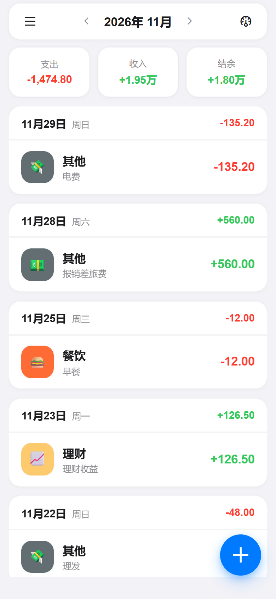
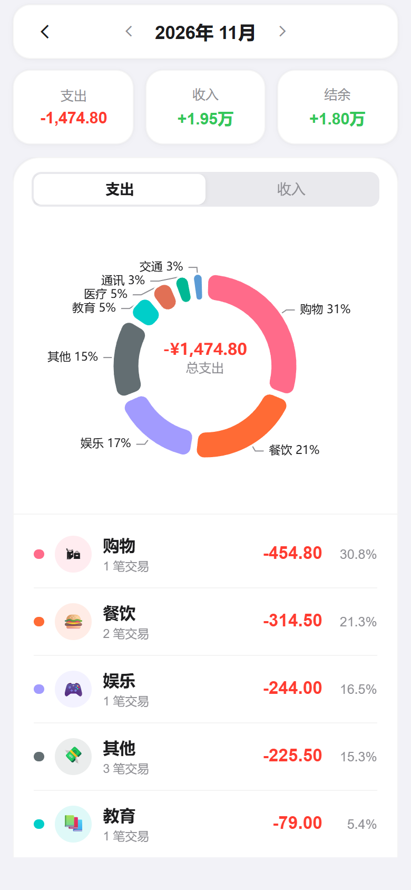
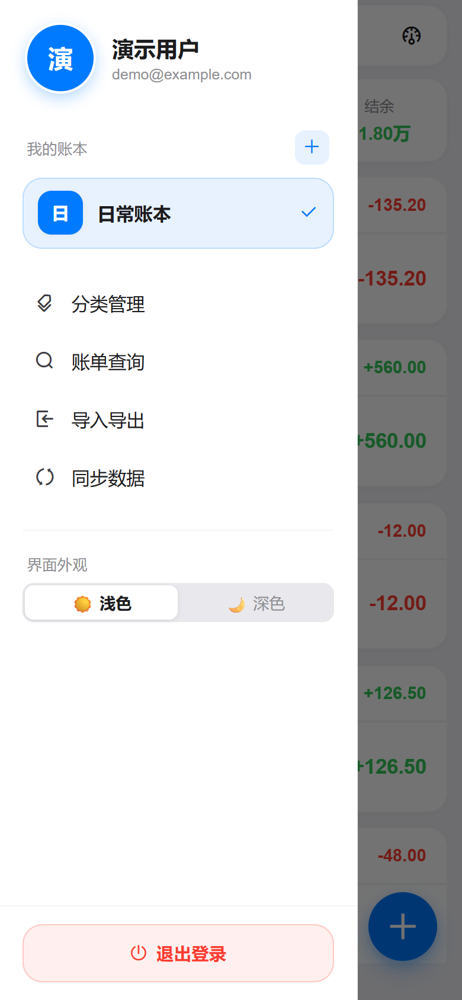
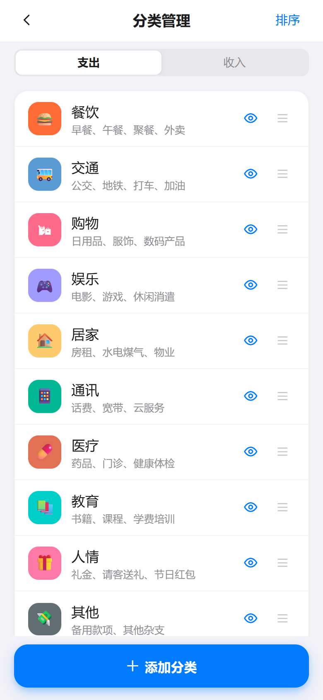
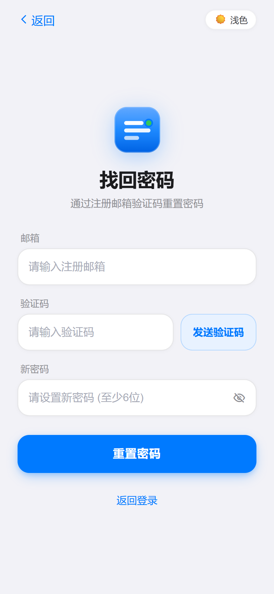

# LedgerPro

个人多账本记账软件（v1.0.0）。采用 Apple HIG 视觉风格，支持**浅色 / 深色双主题切换**、多账本数据隔离、自定义分类排序与显隐、多维账单搜索、多格式导入导出（JSON / CSV / XLSX）、离线优先同步及可视化统计图表。

## 核心特性

- **多账本隔离**：支持创建、切换、重命名、删除多个账本，账单数据按 `book_id` 严格隔离。
- **双主题外观**：内置 Apple HIG 风格浅色（Light）与深色（Dark）主题，支持一键切换与持久化记忆。
- **离线优先与自动同步**：本地优先存储账单流水，支持下拉刷新、定时与网络恢复自动增量同步。
- **可视化统计与大数格式化**：基于 ECharts 环形图与分类占比排行展示月度收支；万元、亿元级大金额自动格式化为 `x.xx万` / `x.xx亿`。
- **分类管理与账单检索**：支持收支分类添加、拖拽排序（SortableJS）、显隐控制，以及按关键词、分类、收支类型多维筛选账单。
- **导入导出**：支持 JSON、CSV、Excel（`.xlsx`）账单批量导入预览与导出备份。

## 技术栈

| 层     | 技术                                                                |
| ------ | ------------------------------------------------------------------- |
| 前端   | uni-app 3.0 (Vue 3 + TypeScript + Vite 5) + Wot UI + ECharts 6      |
| 后端   | Spring Boot 4.0 + Java 21 + MyBatis-Plus 3.5 + Spring Security      |
| 数据库 | MySQL 8.0 + Redis 7                                                 |
| 认证   | JWT 双 Token (access 24h + refresh 7d) + RSA 密码加密 + BCrypt      |
| 部署   | Docker Compose (nginx + backend + mysql + redis)                    |

## 项目结构

```text
ledger_pro/
├── AGENTS.md          # 全局开发规范与架构约束指南
├── document/          # specs/ design/ plans/ reports/ reference/ images/
├── front_end/         # uni-app 前端工程 (H5 / 小程序 / App)
└── back_end/          # Spring Boot 后端工程 (端口 8114, 上下文 /api/v1)
```

## 快速开始

### 前端

```bash
cd front_end
pnpm install
cp .env.example .env      # 编辑配置
pnpm dev:h5               # 启动 H5 开发服务器 (http://localhost:5173)
```

### 后端

```bash
cd back_end
cp .env.example .env       # 编辑 DB / JWT_SECRET / Redis / 邮件配置（Spring Boot 自动加载 .env）
mvn spring-boot:run        # 启动开发服务器 (http://localhost:8114/api/v1)
```

> 使用 VS Code 启动/调试后端时，工作区已配置 `.vscode/launch.json` 自动加载 `back_end/.env` 环境变量。

## Docker 部署

```bash
cd back_end
mvn clean package -DskipTests
docker-compose build --no-cache backend
docker-compose up -d
```

4 个容器：nginx (80) → backend + mysql + redis。数据挂载到 `D:/data_center/prod/`。

## 测试与代码规范

```bash
# 前端类型检查与单元测试
cd front_end
pnpm type-check
pnpm test:unit
pnpm test:comp

# 前端 E2E 测试（需要后端 + 前端 dev server 运行中）
pnpm test:e2e
pnpm test:e2e -- --grep "Auth"

# 后端单元测试与代码格式化
cd back_end
mvn test
mvn spotless:apply
```

## 更多文档

详细架构设计、安全策略、同步机制与开发规范见 [AGENTS.md](./AGENTS.md) 与 [CLAUDE.md](./CLAUDE.md)。

## 页面预览

### 浅色模式 (Light Mode)

<p align="center">
  
  
  
</p>
<p align="center">
  
  
  
</p>

### 深色模式 (Dark Mode)

<p align="center">
  
  
  
</p>
