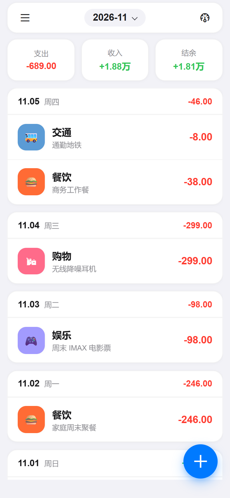
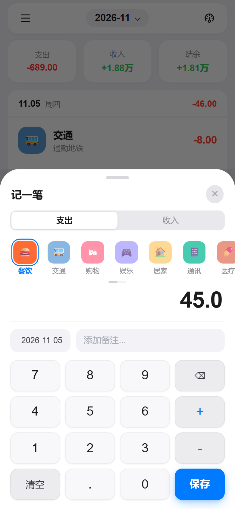
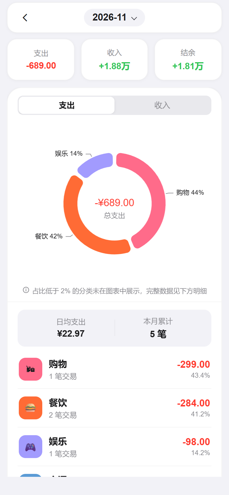
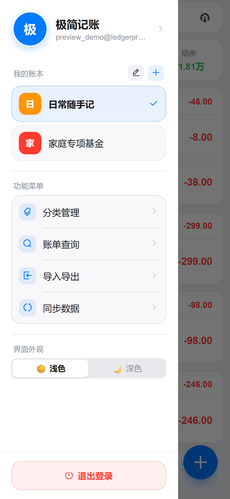
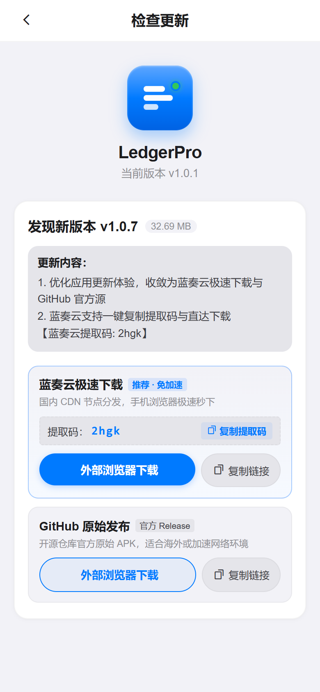
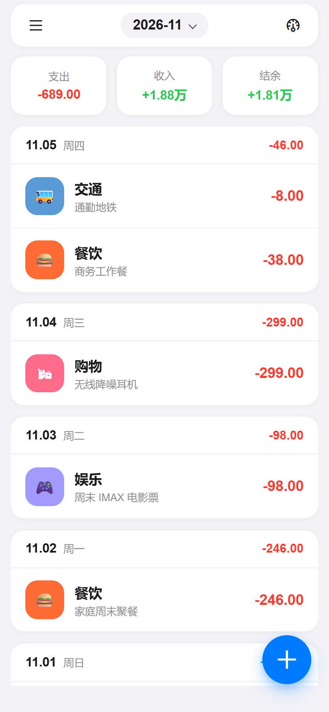
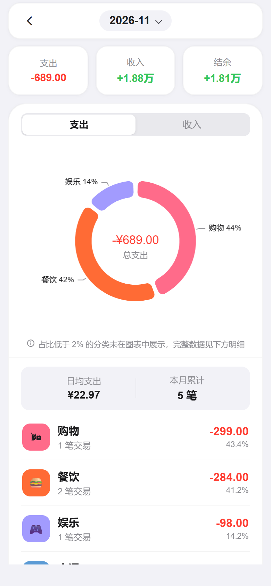

# LedgerPro

个人多账本极简记账软件。采用 Apple HIG（Human Interface Guidelines）设计风格，支持**浅色 / 深色（Light / Dark）双主题自适应**、多账本物理级数据隔离、分类拖拽排序与显隐管理、多维账单检索、多格式导入导出（Excel / CSV / JSON）、离线优先与增量同步，以及可视化收支统计分析图表。

---

## 📸 页面预览

### 浅色模式 (Light Mode)

<p align="center">
  
  
  
</p>
<p align="center">
  
  
  
</p>

### 深色模式 (Dark Mode)

<p align="center">
  
  
  
</p>

---

## ✨ 核心功能特性

- **多账本数据隔离**：支持创建、切换、重命名及删除多个独立账本（如“日常消费”、“家庭生活”、“旅行基金”等），所有账单数据基于 `book_id` 实现物理级硬隔离。
- **极简高效记账**：数字键盘快速输入，智能记住最近分类；支出 / 收入双向记账，支持自定义交易时间与备注。
- **自定义分类与交互排序**：内置丰富分类图标库，支持新增自定义分类、分类显隐切换以及基于 SortableJS 的流畅拖拽排序交互。
- **离线优先与多端增量同步**：本地持久化轻量缓存，弱网或断网离线环境随心记；支持下拉刷新、网络恢复自动触发平滑增量同步与防并发冲突校验。
- **可视化资产洞察与统计**：基于 ECharts 环形图与收支排行直观呈现分类开销；万元、亿元级大金额智能自适应格式化展示（`x.xx万` / `x.xx亿`）。
- **多维账单搜索与明细查看**：支持按关键词、交易分类、收支类型及月份范围快速联合筛选，账单详情弹窗支持随时编辑与物理/逻辑删除。
- **多格式导入导出与备份**：支持 Excel（`.xlsx`）、CSV 以及标准 JSON 格式的账单数据批量导入与导出备份，数据自主掌控。
- **账户安全与接口防刷机制**：
  - 图形验证码防刷机制，有效拦截自动化机器人撞库；
  - 密码前端 RSA 公钥加密传输，后端私钥解密并经 BCrypt 强盐哈希落库；
  - 双 Token 认证模型（Access Token 24h + Refresh Token 7d），前端无感刷新重试。
- **双主题外观**：严格遵循 Apple HIG 视觉设计规范，提供浅色（Light）与深色（Dark）双套精调色彩系统，随心切换并持久化记忆。
- **应用内多渠道检查更新**：客户端内置版本检查与升级提示，同时提供国内高速免加速渠道（蓝奏云并支持提取码一键复制）与 GitHub 官方源双渠道。

---

## 🛠️ 技术栈清单

### 前端 (Client)
- **核心框架**：uni-app 3.0 (Vue 3 Composition API + TypeScript)
- **构建工具**：Vite 5
- **UI 组件库**：Wot UI (`@wot-ui/ui`)
- **状态管理**：Pinia
- **图表可视化**：Apache ECharts 6
- **代码规范**：ESLint + Prettier + TypeScript 严格类型检查（零 any 原则）

### 后端 (Server)
- **核心框架**：Spring Boot 3.x / 4.x + Java 21 LTS
- **ORM & 数据层**：MyBatis-Plus 3.5 + MySQL 8.0
- **缓存与状态**：Redis 7
- **认证与安全**：Spring Security + JWT 双 Token 机制 + RSA 加密 + BCrypt
- **单元测试**：JUnit 5 + Mockito + AssertJ
- **代码规范**：Spotless (google-java-format)

---

## 📁 目录结构

```text
ledger_pro/
├── AGENTS.md          # 架构设计与全局工程开发规范指南
├── document/          # 需求文档、设计契约与架构参考
│   ├── design/        # 架构与设计说明
│   ├── specs/         # PRD 产品需求、API 契约、数据库 Schema
│   └── images/        # 页面高清预览与展示图集
├── front_end/         # 前端工程 (uni-app / Vue 3 / TS / Vite 5)
│   ├── src/           # 页面 (pages/)、组件 (components/)、状态 (stores/)、接口 (api/)
│   └── tests/         # 单测 (vitest) 与端到端测试 (playwright)
└── back_end/          # 后端工程 (Spring Boot / Java 21 / MyBatis-Plus)
    ├── src/main/      # 业务代码 (controller, service, mapper, entity, config)
    └── src/test/      # 单元测试与测试套件
```

---

## 🚀 本地研发环境搭建

### 1. 基础环境准备
- **Node.js**：`>= 18.18.0`（推荐使用 `pnpm 9+`）
- **Java JDK**：`>= 21` (推荐 Eclipse Temurin 或 Oracle OpenJDK 21)
- **Maven**：`>= 3.8.0`
- **本地中间件**：MySQL 8.0（端口 3306）与 Redis 7（端口 6379）

> 💡 **快速启动本地研发数据库（可选 Docker 方式）**：  
> 若本地未安装独立的 MySQL 与 Redis，可在后端工程内通过开发编排文件一键启动容器：  
> ```bash
> docker compose -f back_end/docker/docker-compose.dev.yml up -d
> ```
> 容器初次拉起将自动执行 `back_end/docker/init.sql` 完成数据库及初始表结构初始化。

---

### 2. 后端本地启动 (Spring Boot)

1. 进入后端目录：
   ```bash
   cd back_end
   ```
2. 检查或配置本地环境变量：
   可基于 `src/main/resources/application-dev.yaml` 配置本地数据库连接（默认连接 `127.0.0.1:3306/ledger_pro`，用户 `root`），或在 `back_end/.env.local` 中进行自定义覆盖。
3. 启动开发服务（监听端口 `8114`，接口上下文 `/api/v1`）：
   ```bash
   mvn spring-boot:run
   ```
4. 验证后端连通性：
   浏览器或终端访问 `http://localhost:8114/api/v1/health`，返回 `{"code":200,"data":{"status":"UP"},"message":"成功"}` 即表示启动成功。

---

### 3. 前端本地启动 (uni-app H5)

1. 进入前端目录：
   ```bash
   cd front_end
   ```
2. 安装依赖：
   ```bash
   pnpm install
   ```
3. 启动 H5 开发调试服务器：
   ```bash
   pnpm dev:h5
   ```
4. 在浏览器中打开 `http://localhost:5173` 即可开启记账体验。  
   *注：`vite.config.ts` 已默认配置反向代理，所有 `/api` 请求将自动转发至本地后端 `http://127.0.0.1:8114`。*

---

## 🧪 日常精准校验与代码规范

本项目遵循“改哪测哪、最小作用域验证”原则，日常开发推荐使用以下精准检查命令：

```bash
# 前端：TypeScript 类型安全检查
cd front_end
pnpm type-check

# 前端：运行受改动影响的单个单元测试文件
npx vitest run src/stores/__tests__/categoryStore.test.ts

# 后端：依赖编译与语法检查
cd back_end
mvn test-compile

# 后端：针对单个测试类精准执行
mvn test -Dtest=SystemControllerTest

# 后端：Java 代码风格自动格式化
mvn spotless:apply
```

---

## 📄 开源许可证

本项目基于 [MIT 许可证](LICENSE) 授权。
