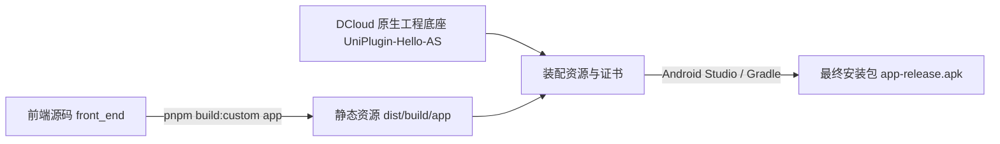

# LedgerPro — Android 本地离线打包与部署全流程教程

本文档详细指导如何基于 **Android Studio** 与 **uni-app 官方 Android 离线 SDK**，将 **LedgerPro** 记账应用从源码编译并打包为独立的 Android APK 安装包，同时包含后端服务与局域网联调的必要配置说明。

---

## 目录
1. [核心架构与打包原理](#一核心架构与打包原理)
2. [本地环境与软件准备](#二本地环境与软件准备)
3. [打包前准备：联调配置与后端启动](#三打包前准备联调配置与后端启动)
4. [步骤一：Android Studio 初始化配置](#四步骤一android-studio-初始化配置)
5. [步骤二：下载与准备 DCloud 离线 SDK 工程](#五步骤二下载与准备-dcloud-离线-sdk-工程)
6. [步骤三：生成 Android 签名证书 (Keystore) 与提取 SHA1](#六步骤三生成-android-签名证书-keystore-与提取-sha1)
7. [步骤四：在 DCloud 开发者中心申请离线 AppKey](#七步骤四在-dcloud-开发者中心申请离线-appkey)
8. [步骤五：编译前端 App 离线静态资源](#八步骤五编译前端-app-离线静态资源)
9. [步骤六：装配前端资源至 Android Studio 原生工程](#九步骤六装配前端资源至-android-studio-原生工程)
10. [步骤七：配置原生工程参数（AppID / 包名 / AppKey）](#十步骤七配置原生工程参数appid--包名--appkey)
11. [步骤八：执行 Gradle 构建生成 APK](#十一步骤八执行-gradle-构建生成-apk)
12. [常见排错与踩坑指南](#十二常见排错与踩坑指南)

---

## 一、核心架构与打包原理

LedgerPro 前端是基于 **uni-app 3.0 (Vue 3 + TypeScript + Vite)** 开发的多端应用。
Android Studio 是原生开发环境，不能直接识别 Vue 单文件组件。因此，离线打包遵循以下经典机制：



* **前端离线资源**：通过编译器打包为 HTML、CSS、JS、静态资源包。
* **原生宿主底座**：DCloud 官方提供的 Android 原生空壳工程（内置了 5+ 运行时引擎）。
* **安全鉴权机制**：DCloud 要求 **包名 (Package Name)** + **证书签名 SHA1** + **AppID** 必须在开发者后台绑定生成独一无二的 **AppKey**，否则应用启动会白屏或弹窗拦截。

---

## 二、本地环境与软件准备

| 软件/环境 | 推荐版本 | 本机状态 | 作用 |
| :--- | :--- | :--- | :--- |
| **Node.js** | v20+ / v24+ | 已安装 (v24.9.0) | 前端编译运行环境 |
| **pnpm** | v9+ / v10+ | 已安装 (v10.28.0) | 前端包依赖管理 |
| **Java JDK** | 21 LTS | 已安装 (21.0.11) | 后端 Spring Boot 与 Gradle 构建 |
| **Android Studio** | 2024+ (Ladybug / Koala 等) | 已下载安装 | 原生 Android 编译与 APK 输出 |
| **Docker** | 24+ | 已安装 (v29.7.2) | 运行 MySQL 8.0 与 Redis 服务 |

---

## 三、打包前准备：联调配置与后端启动

> [!IMPORTANT]
> 手机 App 安装后必须与后端服务器通信才能登录和记账。手机中的 `localhost` 指向手机自身，必须将前端请求指向**电脑的局域网 IP**。

### 1. 查询电脑局域网 IP
在 Windows 终端中执行：
```powershell
ipconfig
```
记录下你的 `IPv4 地址`（例如：`192.168.1.105`）。

### 2. 修改前端环境变量
打开 `front_end/.env` 或新建 `front_end/.env.local`：
```properties
VITE_API_BASE_URL=http://192.168.1.105:8114
```
*(注意：端口号为 8114，请将 IP 替换为你本机的局域网 IPv4 地址)*

### 3. 启动 MySQL、Redis 与后端服务
```powershell
# 1. 启动 MySQL 8.0 容器
docker run -d --name ledger-mysql -p 3306:3306 -e MYSQL_ROOT_PASSWORD=root -e MYSQL_DATABASE=ledger_pro mysql:8.0

# 2. 启动 Redis 容器
docker run -d --name ledger-redis -p 6379:6379 redis:7

# 3. 使用数据库工具 (如 DBeaver) 执行 document/specs/schema.sql 初始化数据库结构

# 4. 打包并启动后端
cd back_end
mvn clean package -DskipTests
java -jar target/back_end-0.0.1-SNAPSHOT.jar
```

---

## 四、步骤一：Android Studio 初始化配置

1. 打开 **Android Studio**，若是初次安装，跟随 **Setup Wizard** 引导选择 **Standard**，完成默认组件下载。
2. 进入欢迎页或主界面，打开 **SDK Manager**（路径：`More Actions` -> `SDK Manager`，或顶部菜单 `File` -> `Settings` -> `Appearance & Behavior` -> `System Settings` -> `Android SDK`）：
   * **SDK Platforms**：勾选 `Android 13.0 (Tiramisu, API 33)` 或 `Android 14.0 (UpsideDownCake, API 34)`。
   * **SDK Tools**：勾选：
     * `Android SDK Build-Tools`
     * `Android SDK Command-line Tools (latest)`
     * `Android SDK Platform-Tools`
   * 点击 **Apply** 并同意协议，等待下载安装完毕。

---

## 五、步骤二：下载与准备 DCloud 离线 SDK 工程

1. 前往 DCloud 官方文档下载离线 SDK：
   * **官方下载链接**：[https://nativesupport.dcloud.net.cn/AppDocs/download/android.html](https://nativesupport.dcloud.net.cn/AppDocs/download/android.html)
   * 下载最新稳定版本的 `Android-SDK@...zip` 并解压。
2. 解压后会看到如下目录：
   * `UniPlugin-Hello-AS/`：**【官方推荐的原生工程底座】**，本项目使用此目录。
   * `HBuilder-Hello/`：基础纯 Native 示例。
   * `SDK/`：核心 aar 库文件。
3. 打开 Android Studio，点击 **Open**，选择并打开解压出来的 **`UniPlugin-Hello-AS`** 目录。
4. 首次打开时，Gradle 会自动联网下载构建工具（若出现提示，选择 `Trust Project`），等待底部进度条跑完。

---

## 六、步骤三：生成 Android 签名证书 (Keystore) 与提取 SHA1

原生 Android 要求每一个 APK 安装包都必须由证书签名。

### 1. 在 Android Studio 中图形化生成
1. 顶部菜单点击：**Build** $\rightarrow$ **Generate Signed Bundle / APK...**。
2. 选择 **APK**，点击 **Next**。
3. 在 `Key store path` 下方点击 **Create new...**：
   * **Key store path**：指定保存位置，如 `D:\ledger_pro.jks`。
   * **Password** 与 **Confirm**：设置密码（如 `123456`，请务必记牢）。
   * **Alias**（别名）：例如 `ledgerpro`。
   * **Password**（别名密码）：保持一致或设置自定义密码。
   * **Validity (years)**：有效期建议填 `25` 年以上。
   * **Certificate 字段**：在 `First and Last Name` 填入 `LedgerPro`，其余字段可填默认或留空。
4. 点击 **OK** 完成创建，随后点击 **Cancel** 退出生成窗口。

### 2. 提取证书的 SHA1 指纹
打开 PowerShell 终端，执行：
```powershell
keytool -list -v -keystore D:\ledger_pro.jks -alias ledgerpro -storepass 123456
```
在控制台输出的内容中找到：
```text
Certificate fingerprints:
     SHA1: AA:BB:CC:DD:EE:FF:11:22:33:44:55:66:77:88:99:00:11:22:33:44
```
**将这行完整的 SHA1 十六进制字符串复制保存**。

---

## 七、步骤四：在 DCloud 开发者中心申请离线 AppKey

> [!CAUTION]
> 这是离线打包最容易忽略的步骤。未配置或配置错误的 AppKey 会导致 App 启动后立即白屏或弹出鉴权失败提示！

1. **登录开发者中心**：访问 [DCloud 开发者中心 (dev.dcloud.net.cn)](https://dev.dcloud.net.cn/)，登录你的 DCloud 账号。
2. **创建应用**：
   * 点击 **【创建应用】**，类型选择 **uni-app**。
   * 应用名称填：`LedgerPro`。
   * 创建成功后，系统会分配一个唯一的 AppID，格式如：`__UNI__XXXXXXX`（假设为 `__UNI__B8866AA`）。
3. **将 AppID 同步到前端项目**：
   打开 [`front_end/src/manifest.json`](file:///D:/WorkSpace/ledger_pro/front_end/src/manifest.json)，填写 `name` 和分配到的 `appid`：
   ```json
   {
       "name": "LedgerPro",
       "appid": "__UNI__B8866AA",
       "versionName": "1.0.0",
       "versionCode": "100",
       ...
   }
   ```
4. **申请离线 AppKey**：
   * 在 DCloud 开发者中心点击刚刚创建的应用进入详情。
   * 左侧导航栏选择 **【离线打包Key管理】** $\rightarrow$ **【Android】**。
   * **Android 包名 (Package Name)**：自定义一个全局唯一的包名，例如 `com.ledgerpro.app`。
   * **Android 证书签名 (SHA1)**：粘贴上面步骤三中获取的 `SHA1`。
   * 点击 **【保存】**。页面会立即生成对应的 **AppKey**（形如 `c8430e5d...` 的 32 位字符串），复制备用。

---

## 八、步骤五：编译前端 App 离线静态资源

在前端项目根目录执行打包命令：
```powershell
cd D:\WorkSpace\ledger_pro\front_end
pnpm build:custom app
```
终端输出如下信息代表编译成功：
```text
DONE  Build complete.
运行方式：打开 HBuilderX, 导入 dist\build\app 运行。
```
构建产物存放于：`front_end/dist/build/app/`。

---

## 九、步骤六：装配前端资源至 Android Studio 原生工程

1. 打开 Android 离线工程目录：
   `UniPlugin-Hello-AS/app/src/main/assets/apps/`
2. **新建 AppID 目录**：
   在 `apps/` 目录下新建一个文件夹，文件夹名称**必须与你的 AppID 完全一致**，例如：
   `UniPlugin-Hello-AS/app/src/main/assets/apps/__UNI__B8866AA/`
3. **新建 www 目录**：
   在刚刚新建的目录中再创建一个名为 `www` 的子文件夹：
   `UniPlugin-Hello-AS/app/src/main/assets/apps/__UNI__B8866AA/www/`
4. **拷贝资源**：
   将 `front_end/dist/build/app/` 下的**所有文件和子文件夹**（包括 `manifest.json`, `app-service.js`, `pages/`, `static/` 等），完整复制到上述 `www/` 目录中。

*装配后的目录结构如下：*
```text
UniPlugin-Hello-AS/
└── app/
    └── src/main/assets/
        ├── data/
        │   └── dcloud_control.xml
        └── apps/
            └── __UNI__B8866AA/
                └── www/
                    ├── manifest.json
                    ├── app-config-service.js
                    ├── app-service.js
                    ├── app.css
                    ├── pages/
                    └── static/
```

---

## 十、步骤七：配置原生工程参数（AppID / 包名 / AppKey）

在 Android Studio 中打开 `UniPlugin-Hello-AS`，修改以下三个文件：

### 1. 修改 `app/src/main/assets/data/dcloud_control.xml`
将 `<app>` 标签内的 `appid` 修改为你的实际 AppID：
```xml
<hbuilder>
<apps>
    <app appid="__UNI__B8866AA" appver="1.0.0"/>
</apps>
</hbuilder>
```

### 2. 修改 `app/build.gradle`
找到 `defaultConfig` 块，确保 `applicationId` 与 DCloud 平台申请时填写的包名一致：
```groovy
defaultConfig {
    applicationId "com.ledgerpro.app"  // 必须与 DCloud 填写的包名完全一致
    minSdkVersion 21
    targetSdkVersion 33
    versionCode 100
    versionName "1.0.0"
    ...
}
```

配置前面生成的签名证书：
```groovy
android {
    ...
    signingConfigs {
        release {
            storeFile file("D:/ledger_pro.jks") // 证书物理路径
            storePassword "123456"
            keyAlias "ledgerpro"
            keyPassword "123456"
            v1SigningEnabled true
            v2SigningEnabled true
        }
    }

    buildTypes {
        release {
            signingConfig signingConfigs.release
            minifyEnabled false
            proguardFiles getDefaultProguardFile('proguard-android.txt'), 'proguard-rules.pro'
        }
    }
}
```

### 3. 修改 `app/src/main/AndroidManifest.xml`
找到 `<application>` 节点内的 `dcloud_appkey` meta-data 标签，填入你申请到的 32 位 AppKey：
```xml
<application
    android:name="io.dcloud.application.DCloudApplication"
    android:allowBackup="true"
    android:icon="@drawable/icon"
    android:label="@string/app_name"
    android:networkSecurityConfig="@xml/network_security_config"
    android:supportsRtl="true">

    <!-- 填入 DCloud 后台生成的 AppKey -->
    <meta-data
        android:name="dcloud_appkey"
        android:value="填入您的32位DCloud_AppKey" />

</application>
```

*(可选) 修改应用桌面名称：打开 `app/src/main/res/values/strings.xml`，修改 `<string name="app_name">LedgerPro 记账</string>`。*

---

## 十一、步骤八：执行 Gradle 构建生成 APK

1. **同步 Gradle 配置**：
   点击 Android Studio 界面右上角的 **Sync Project with Gradle Files** 图标（大象图标），等待 Gradle 配置同步完成（状态栏显示 `BUILD SUCCESSFUL`）。
2. **开始打包**：
   点击顶部菜单栏：**Build** $\rightarrow$ **Generate Signed Bundle / APK...**。
3. 选择 **APK**，点击 **Next**。
4. 勾选或输入证书路径 `D:\ledger_pro.jks`、别名与密码，点击 **Next**。
5. **构建选项**：
   * **Destination Folder**：选择生成 APK 的输出目录（如桌面）。
   * **Build Variants**：选中 **`release`**。
   * **Signature Versions**：勾选 **`V1 (Jar Signature)`** 和 **`V2 (Full APK Signature)`**。
6. 点击 **Finish**，Android Studio 开始执行构建。
7. 构建完成后，右下角会弹出系统通知：
   > **Generate Signed APK: Successfully generated for 'app'**
8. 点击通知中的 **locate**，即可看到生成的 `app-release.apk`。

将该 APK 传到 Android 手机安装即可直接运行！

---

## 十二、常见排错与踩坑指南

### 1. 启动后弹出“未配置 AppKey 或配置错误”
* **原因**：以下四项中至少有一项不匹配：
  1. `AndroidManifest.xml` 中的 `dcloud_appkey` 填写有误或有空格；
  2. `build.gradle` 中的 `applicationId`（包名）与 DCloud 后台填写的不一致；
  3. 打包使用的 `.jks` 证书 SHA1 与 DCloud 后台填写的 SHA1 不一致；
  4. `dcloud_control.xml` / `manifest.json` 中的 `appid` 与 DCloud 后台的不一致。
* **解决办法**：重新核对上述四要素，确保与 DCloud 后台一一对应。

### 2. 启动后显示空白屏幕 (White Screen)
* **原因**：资源路径放置错误。
* **解决办法**：检查 `app/src/main/assets/apps/` 下的文件夹名称是否是你的 `appid`，且该文件夹下是否有一层 `www` 目录，前端构建出来的文件（如 `manifest.json`, `app-service.js`）是否直接平铺在 `www/` 根下。

### 3. 手机 App 无法登录，提示网络连接失败
* **原因 A（IP配置）**：前端请求的不是电脑的局域网 IP，而是 `localhost`。请检查 `front_end/.env` 中的 `VITE_API_BASE_URL` 并重新执行 `pnpm build:custom app` 复制资源。
* **原因 B（同一 Wi-Fi）**：手机与运行后端的电脑未连接在同一个 Wi-Fi 网络下。
* **原因 C（Windows 防火墙拦截）**：Windows Defender 防火墙拦截了入站连接。可在 Windows 控制面板搜索“Windows Defender 防火墙” $\rightarrow$ “高级设置” $\rightarrow$ “入站规则” $\rightarrow$ 新建规则放行 `8114` 端口 TCP 访问。
